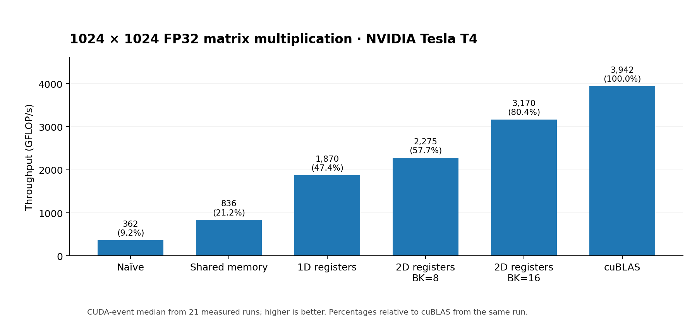
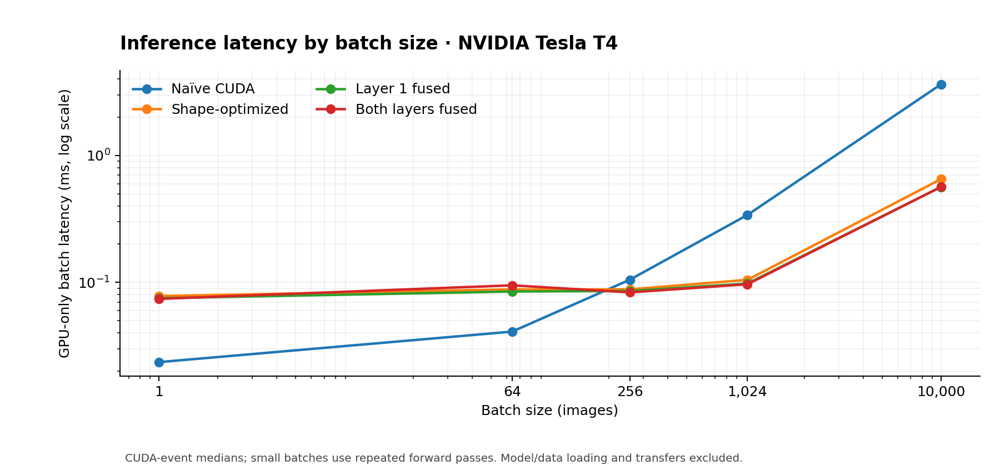

# CUDA GEMM Optimization & MNIST Inference

**From a one-thread-per-output matrix multiply to a register-blocked, fused GPU
inference engine.** This project implements FP32 matrix multiplication in CUDA
C++ from scratch, benchmarks successive optimizations against NVIDIA cuBLAS, and
applies the kernels to a two-layer MNIST neural network (784 → 128 → 10) trained
in PyTorch.

**Highlights (NVIDIA Tesla T4, compute capability 7.5):**

- **80.4% of cuBLAS SGEMM throughput** on a 1024 × 1024 matrix multiplication:
  **3,169.7 GFLOP/s** (measured in one benchmark session).
- **6.43× faster GPU-only inference** than the naive CUDA implementation on a
  batch of 10,000 MNIST images (**3.6371 ms → 0.5652 ms**) in the batch-sweep run.
- **5 → 2 CUDA kernel launches** by fusing bias addition and ReLU into
  matrix-multiplication epilogues.
- **97.38% MNIST test accuracy**, with **10,000 / 10,000 predictions matching
  PyTorch** and zero logits outside the numerical tolerance.

This is an **educational GPU performance-engineering project**, not a replacement
for cuBLAS or a production inference framework. The emphasis is on
implementation, controlled benchmarking, correctness, and understanding when
optimizations do (or don't) help.

## Results overview

All results were measured on an NVIDIA Tesla T4 (`sm_75`) in Google Colab.

### GEMM optimization ladder

Every kernel computes row-major FP32 `C (M × N) = A (M × K) · B (K × N)` and is
validated against cuBLAS. The table below uses the same 1024 × 1024 × 1024
workload and benchmark run for every implementation.



| Kernel | Median time (ms) ↓ | Throughput (GFLOP/s) ↑ | % of cuBLAS |
|:--|--:|--:|--:|
| Naive: one thread per output | 5.9287 | 362.2 | 9.2% |
| Shared-memory tiling | 2.5702 | 835.5 | 21.2% |
| 1D register blocking | 1.1482 | 1,870.3 | 47.4% |
| 2D register blocking (`BK=8`) | 0.9438 | 2,275.3 | 57.7% |
| **2D register blocking (`BK=16`)** | **0.6775** | **3,169.7** | **80.4%** |
| NVIDIA cuBLAS SGEMM | 0.5447 | 3,942.2 | 100% |

Throughput uses the standard GEMM convention:

```
GFLOP/s = (2 × M × N × K) / (elapsed_seconds × 1e9)
```

cuBLAS runs in plain FP32 mode (no TF32 tensor cores) for a like-for-like
comparison.

The benchmark also covers square matrices of size 512, 2048, and 4096, plus both
MLP layer shapes. The best kernel's share of cuBLAS varies with shape: 86.4% at
512, 80.4% at 1024, but about 50% at 2048 and 4096. On the narrow output layer
(`M=10000, K=128, N=10`), **simple shared-memory tiling beat 2D register
blocking** (0.0635 ms vs. 0.0656 ms for the `BK=16` variant). A 64-column output
tile covers only 10 real columns there, so most of each block's threads have no
work, while a 16 × 16 tile wastes far less. Larger tiles are not universally
better.

Full measurements: [`results/gemm_results.csv`](results/gemm_results.csv).

### Neural-network inference

The model is `Linear(784, 128) → ReLU → Linear(128, 10)`, trained in PyTorch for
5 epochs and exported as raw float32 files that the CUDA program loads.

```text
10,000 × 784 input images (flattened, normalized)
           │
           ▼
     Linear (784 → 128) ──► Bias ──► ReLU
           │
           ▼
      Linear (128 → 10) ──► Bias
           │
           ▼
       10 digit logits ──► Argmax
```

`mlp_benchmark` runs the forward pass in one of four configurations:

| Flag | Layer 1 | Layer 2 | Kernel launches |
|:--|:--|:--|--:|
| `--naive` | naive GEMM, then bias, then ReLU | naive GEMM, then bias | 5 |
| `--unfused` | 2D register blocking, then bias, then ReLU | shared-memory tiling, then bias | 5 |
| `--fuse-layer1` | 2D register blocking with fused bias + ReLU | shared-memory tiling, then bias | 3 |
| `--fused` (default) | 2D register blocking with fused bias + ReLU | shared-memory tiling with fused bias | 2 |

Layer 1 uses 2D register blocking (`BM=64, BN=64, BK=16, TM=4, TN=4`); layer 2
uses 16 × 16 shared-memory tiling, which suits its ten output columns better
(see above).

GPU-only batch latency from a single batch-size sweep, 10,000 images:

| Mode | GPU kernel launches | Median latency (ms) ↓ | Speedup vs. naive |
|:--|--:|--:|--:|
| Naive | 5 | 3.6371 | 1.00× |
| Shape-optimized GEMM, unfused | 5 | 0.6509 | 5.59× |
| First-layer fusion | 3 | **0.5643** | **6.45×** |
| Both layers fused | **2** | 0.5652 | 6.43× |

Fusing the second layer changes little at this batch size: in this run, the
three-launch version was marginally faster than the two-launch version. The
difference is small enough that it should not be read as a reliable advantage
for either mode without repeated sessions. The main gains come from GEMM
optimization and first-layer fusion.

### Batch size changes the winner



| Images | Naive CUDA (ms) ↓ | Fully fused CUDA (ms) ↓ | Faster mode |
|--:|--:|--:|:--|
| 1 | **0.0235** | 0.0740 | Naive |
| 64 | **0.0409** | 0.0947 | Naive |
| 256 | 0.1048 | **0.0833** | Fused |
| 1,024 | 0.3399 | **0.0965** | Fused |
| 10,000 | 3.6371 | **0.5652** | Fused |

At small batch sizes, the 64 × 64 output tiles are mostly empty and
synchronization and launch overhead dominate. At larger batches, data reuse and
register blocking give much better throughput. This suggests **batch-size-aware
dispatch** as a possible future improvement.

Raw measurements: [`results/batch_sweep.csv`](results/batch_sweep.csv).

### Data transfers matter

For the fully fused 10,000-image batch, the same sweep recorded:

| Stage | Time |
|:--|--:|
| Pageable host → device input transfer | 6.8101 ms |
| GPU kernels | 0.5652 ms |
| Device → host output transfer | 0.1254 ms |
| **Sum of measured stages** | **7.5007 ms** |

The input transfer accounts for roughly **91%** of that sum, so the kernel-only
speedup is not the same as the transfer-inclusive speedup: compared with naive
CUDA, the latter is about **1.40×** in this experiment.

**Timing boundaries:** model weights are copied to the GPU once before
measurement. Each reported time is the median of 30 measurements after 5 warm-up
runs. Transfer-inclusive times are the sum of separately measured pageable-memory
copies and GPU execution; they **do not** include file I/O, model
initialization, allocations, or other application overhead. Small batches repeat
the forward pass back to back within each measurement (roughly 10,000 images'
worth) so the timing is above CUDA event resolution. That measures sustained time
per batch, which can include launch-submission gaps, not the latency of a single
isolated request.

## Optimization techniques

| Stage | Technique | Why it matters |
|:--|:--|:--|
| 1 | Naive GEMM (`naiveGemm`) | Correctness baseline: one thread computes one output element. |
| 2 | Shared-memory tiling (`tiledGemm`) | Each block stages 16 × 16 tiles of A and B in shared memory, reusing each loaded value 16 times instead of reloading it from global memory. |
| 3 | 1D register blocking (`blocktiling1dGemm`) | Each thread computes 8 outputs in a column, reusing one value of B from a register for all 8. |
| 4 | 2D register blocking (`blocktiling2dGemm`) | Each thread computes a 4 × 4 output sub-tile as an outer product of register-cached values of A and B. |
| 5 | Larger K tile (`BK=16`) | Processes more of the reduction per tile load, halving the number of synchronizations; the benefit depends on matrix size. |
| 6 | Shape-aware kernel choice | Register blocking for the wide hidden layer, simpler tiling for the narrow output layer. |
| 7 | Fused epilogues | `tiledGemm` and `blocktiling2dGemm` take a compile-time flag that applies bias (and, for the 2D kernel, ReLU) before the final write, removing separate passes over the output and their kernel launches. |

The kernels handle partial edge tiles, so any M, K, and N work.

## Correctness

`gemm_bench` checks every kernel against cuBLAS (and spot-checks cuBLAS against
a CPU computation), filling the output with NaNs first so a kernel that skips
elements cannot pass.

`mlp_benchmark` compares every output logit against reference logits exported
from PyTorch for the same trained model, and exits with an error if any differ.
The full 10,000-image run produced:

- **10,000 / 10,000** argmax predictions matching PyTorch.
- **9.5367 × 10⁻⁶** maximum absolute logit difference.
- **0** logit mismatches under `abs(cuda - reference) <= 1e-3 + 1e-4 * abs(reference)`.
- **9,738 / 10,000 correct** MNIST predictions (**97.38% accuracy**).

Batch sizes that are not multiples of the tile size (including 1, 2, 15, 17, 63,
65, and 9,999 images) also passed for the optimized modes.

## Building and running

**Requirements:** an NVIDIA GPU, the CUDA Toolkit (`nvcc` and cuBLAS), and a
C++17 host compiler. The results above were measured on a Tesla T4 with CUDA
13.0 in Google Colab ([`notebooks/colab_workflow.ipynb`](notebooks/colab_workflow.ipynb)).
Python and PyTorch are only needed to retrain the model; the exported weights
and test data are committed.

Build from the repo root:

```bash
git clone https://github.com/loganKneller/cuda-matmul-optimization.git
cd cuda-matmul-optimization
make                  # builds ./mlp_benchmark and gemm/gemm_bench
make ARCH=sm_75       # if nvcc does not support -arch=native (e.g. on Colab's T4)
```

To target another GPU, set `ARCH` to its compute capability.

Run from the repo root, since `mlp_benchmark` loads `weights/` relative to the
working directory:

```bash
./mlp_benchmark                      # fully fused, all 10,000 images
./mlp_benchmark --naive              # also --unfused, --fuse-layer1, --fused
./mlp_benchmark --fused --batch 64   # first 64 images (1 to 10,000)
./gemm/gemm_bench                    # all kernels vs. cuBLAS on the default shapes
./gemm/gemm_bench 257 129 131        # a single custom M K N shape
```

`gemm_bench` prints a table per shape and writes every result to `results.csv`
in the current directory. `mlp_benchmark` prints a `CSV,` line per run for
collecting results.

### Generating a batch-sweep CSV

```bash
mkdir -p results
printf 'mode,batch,reps,gpu_ms,h2d_ms,d2h_ms,gpu_images_per_s,e2e_images_per_s\n' > results/batch_sweep_new.csv
for mode in --naive --unfused --fuse-layer1 --fused; do
  for batch in 1 64 256 1024 10000; do
    ./mlp_benchmark "$mode" --batch "$batch" | grep '^CSV,' | sed 's/^CSV,//'
  done
done >> results/batch_sweep_new.csv
```

Results depend on device clocks, thermal and power conditions, input shapes, and
how benchmarks are scheduled. Compare runs on the same device with consistent
settings rather than treating one percentage as a universal guarantee.

### Retraining the model

With PyTorch and torchvision installed:

```bash
python python/train_mlp.py     # downloads MNIST to data/, saves weights/mlp/mlp_mnist.pt
python python/export_mlp.py    # writes the CUDA binaries to weights/mlp/
```

`train_linear.py` and `export_linear.py` do the same for the single-layer linear
model in `weights/linear/`.

## Repository layout

```text
cuda-matmul-optimization/
├── Makefile                 builds mlp_benchmark and gemm_bench
├── gemm/
│   ├── kernels.cuh          naive, tiled, 1D/2D register-blocked GEMM; fused variants
│   ├── gemm_bench.cu        correctness checks and timing against cuBLAS
│   └── Makefile
├── mlp/
│   └── mlp_benchmark.cu     four inference modes, batch sizes, validation
├── python/
│   ├── train_mlp.py         trains the 784 → 128 → 10 MLP
│   ├── export_mlp.py        exports weights, test data, and reference logits
│   ├── train_linear.py      trains a single-layer linear classifier
│   └── export_linear.py     exports the linear model for CUDA
├── weights/
│   ├── mlp/                 MLP checkpoint, CUDA binaries, and the full
│   │                        10,000-image test set (full_test/)
│   └── linear/              linear model checkpoint and CUDA binaries
├── results/                 saved benchmark data
│   ├── gemm_results.csv
│   └── batch_sweep.csv
├── assets/                  charts used in this README
├── notebooks/               Colab notebook used to run on a T4
└── archive/                 earlier standalone programs, in build order
```

`archive/` keeps the programs written on the way here, numbered in order: a
vector add, a CPU matrix multiply, a first CUDA matrix multiply, a reader for
the exported test data, linear and MLP inference, and the first tiled MLP
inference. Their kernels have since moved into `gemm/kernels.cuh` and their
benchmarking into `mlp/mlp_benchmark.cu`. Like `mlp_benchmark`, they expect to
be run from the repo root.

## Key takeaways and future work

- **Optimization is shape-dependent.** A large register tile improves throughput
  for large dense products but wastes threads on narrow outputs and tiny batches.
- **Data movement becomes the bottleneck.** Once the GEMMs are fast, the
  host → device transfer dominates transfer-inclusive latency. Keeping inputs
  resident on the device, pinned host memory, and overlapping transfers with
  compute are natural extensions.
- **Kernel fusion has diminishing returns.** Fusing layer 1's bias and ReLU into
  its GEMM gave a measurable gain; fusing the much smaller output bias had little
  effect in this sweep.
- **The gap to cuBLAS grows with size.** The best kernel reached 80–86% of
  cuBLAS at 512 and 1024 but about 50% at 2048 and 4096. Vectorized loads,
  register and occupancy tuning, and profiling with Nsight Compute are the next
  steps; Tensor Cores would be a further one.

## References

- [NVIDIA CUDA C++ Best Practices Guide](https://docs.nvidia.com/cuda/cuda-c-best-practices-guide/)
- [NVIDIA cuBLAS documentation](https://docs.nvidia.com/cuda/cublas/)
- [Simon Boehm, *How to Optimize a CUDA Matmul Kernel for cuBLAS-like Performance*](https://siboehm.com/articles/22/CUDA-MMM):
  background on the progression from naive GEMM to tiled and register-blocked kernels.
